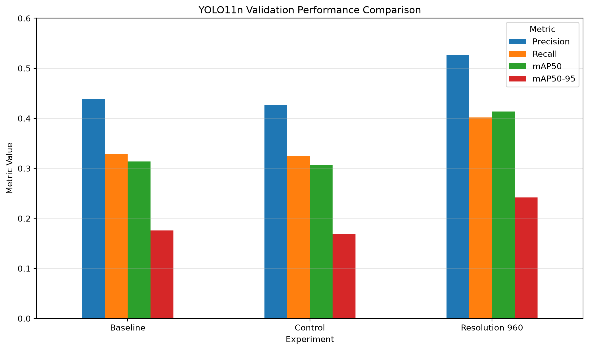
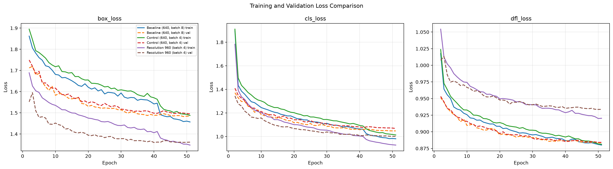

# Advanced Object Detection with YOLO11n

CMPE 401 Instructor-defined Project 1: a baseline and controlled-resolution study of YOLO11n on VisDrone2019-DET.

## Project summary

This project evaluates pretrained YOLO11n on the VisDrone2019-DET object-detection dataset. The dataset conversion keeps the ten VisDrone detection categories and maps them to zero-based YOLO class IDs. The reported split contains 6,471 training images and 548 validation images.

The baseline uses 640-pixel images and batch size 8. A controlled comparison uses a 640-pixel, batch-size-4 control and a 960-pixel, batch-size-4 experiment. All three formal runs used 50 epochs and seed 42.

## Results

Validation results recorded in `results/final_experiment_comparison.csv`:

| Run | Image size | Batch | Precision | Recall | mAP@50 | mAP@50–95 |
|---|---:|---:|---:|---:|---:|---:|
| Baseline | 640 | 8 | 0.4384 | 0.3282 | 0.3137 | 0.1756 |
| Control | 640 | 4 | 0.4260 | 0.3250 | 0.3060 | 0.1690 |
| Resolution experiment | 960 | 4 | 0.5258 | 0.4020 | 0.4138 | 0.2421 |

The batch-matched comparison (960 vs. 640, both batch size 4) improved mAP@50–95 by 0.0731 (7.31 percentage points). Higher resolution may preserve detail for small or crowded objects, which motivated the experiment. This is evidence from one run per configuration; repeated runs are needed to estimate run-to-run variation. The 960-pixel result also uses more computation, so accuracy should be considered alongside runtime and memory needs.





## Dataset setup

Download the VisDrone2019-DET train and validation splits separately. The original machine has local dataset files under `datasets/`; do not add the raw archives or extracted images to GitHub. Download and prepare them locally using this structure:

```text
datasets/
  VisDrone2019-DET-train/
    images/
    annotations/
  VisDrone2019-DET-val/
    images/
    annotations/
```

The conversion script writes YOLO-format images and labels under `datasets/visdrone_yolo/`. It excludes ignored/other categories and keeps the ten detection classes. `configs/visdrone.yaml` points Ultralytics to the converted dataset.

## Environment and reproduction

The recorded runs used Python 3.11.17, PyTorch 2.11.0+cu126, Ultralytics 8.4.177, and an NVIDIA GeForce RTX 3060 Laptop GPU with 6 GB VRAM. Install a PyTorch build compatible with your CUDA-capable system, then install the remaining dependencies:

```powershell
python -m pip install ultralytics==8.4.177 Pillow opencv-python pandas matplotlib
```

The scripts resolve the project root from their own file locations. The dataset YAML uses a project-relative path, and training scripts set the working directory to the project root before starting Ultralytics. No machine-specific path edits are needed.

From the project root, the intended workflow is:

```powershell
python src/convert_visdrone.py
python src/validate_labels.py
python src/train_baseline.py
python src/train_control_640_b4.py
python src/train_experiment1.py
```

Training scripts require a working CUDA GPU. Ultralytics saves `results.csv`, plots, validation visualizations, and checkpoints in `runs/`.

The training entry points now use the recorded run names and settings. When a run directory already exists, Ultralytics creates a numbered directory for the new run rather than overwriting the saved results.

## Repository contents

- `configs/visdrone.yaml` — dataset configuration.
- `docs/project1_analysis.ipynb` — reviewed notebook with training and experiment analysis.
- `.gitignore` — excludes local datasets, model weights, and batch-preview images.
- `src/convert_visdrone.py` — VisDrone-to-YOLO label conversion.
- `src/validate_labels.py` — label and image consistency checks.
- `src/train_*.py` — baseline and experiment training scripts.
- `runs/` — training logs, curves, and evaluation visualizations. Model checkpoints are local-only and excluded from Git history.
- `results/` — comparison tables, charts, and baseline analysis.
- `datasets/` — local dataset archives and generated data; dataset files are not included in a public repository by default.

## Current limitations

- Only one seed/run is available per configuration, so uncertainty is not quantified.
- Bicycle and other difficult categories remain less accurate than car detection; object scale, occlusion, class frequency, and model capacity are possible contributors, but this study does not isolate them.
- The loss curves do not show clear severe overfitting. They also do not establish a definitive global underfitting diagnosis.
- Each configuration has one recorded run, so run-to-run variability has not been measured. Re-running the scripts creates new numbered output folders and does not overwrite the recorded results.
- YOLO-version comparison and VisDrone challenge-test evaluation were not part of the required experiments completed here.

## Key artifacts

- `results/final_experiment_comparison.csv`
- `results/final_experiment_comparison.png`
- `results/training_map5095_comparison.png`
- `results/training_validation_loss_comparison.png`
- `results/per_class_map50_comparison.csv`
- Local best checkpoints: `runs/yolo11n_baseline/weights/best.pt`, `runs/yolo11n_control_640_b4_nb/weights/best.pt`, and `runs/yolo11n_exp1_960/weights/best.pt`. They are excluded by `.gitignore`; use a GitHub Release or Git LFS if the weights need to be distributed.


